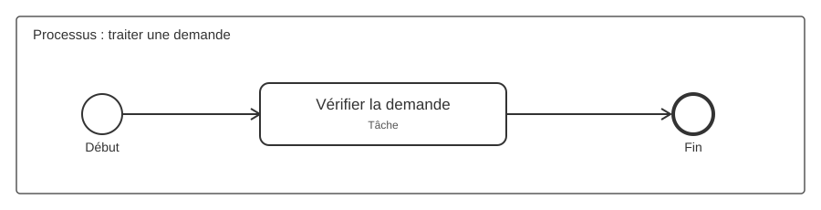
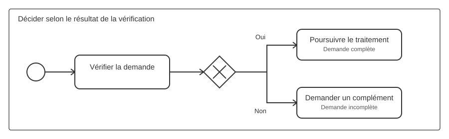
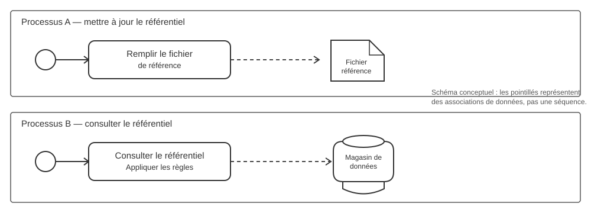

# Règles simples de modélisation BPMN 2.0

> Objectif : disposer d'un guide court et cohérent pour créer, relire et, plus tard, contrôler les diagrammes dans BPMN Tool. Ce document présente des règles pratiques ; il ne remplace pas la spécification BPMN 2.0.

## Illustrations BPMN

Les schémas ci-dessous illustrent les conventions avec une notation BPMN classique. Les fichiers SVG sont des aperçus statiques adaptés à la lecture dans GitHub.

### 1. Événement de début, tâche et événement de fin

Un événement de début lance le processus, une tâche réalise une action et un événement de fin marque la fin du chemin.

### 2. Décision avec une passerelle exclusive

La passerelle exclusive (XOR) dirige le flux vers un seul chemin. Les conditions « Oui » et « Non » sont indiquées sur les flux sortants.

### 3. Fichier et référentiel partagés entre processus

Le premier processus met à jour le fichier ou référentiel ; le second le consulte. Les associations de données en pointillés représentent l'utilisation des données et **ne signifient pas à elles seules que le processus B attend la fin du processus A**. Si une dépendance temporelle est nécessaire, elle doit être modélisée séparément.

## 1. Structure générale

- Décrire un processus avec un objectif clair et un nom explicite, formulé avec un verbe d'action si possible.
- Utiliser un **pool** pour représenter un participant ou un processus indépendant (par exemple : Client, Fournisseur, Entreprise).
- Utiliser des **lanes** dans un pool pour distinguer les rôles, équipes ou responsabilités qui participent au même processus.
- Garder un niveau de détail cohérent dans un même diagramme. Si une activité devient trop complexe, la détailler dans un sous-processus.
- Disposer les étapes dans un sens de lecture constant, généralement de gauche à droite, et limiter les croisements de lignes.

## 2. Événements de début, intermédiaires et de fin

- Un **événement de début** indique ce qui démarre le processus : démarrage simple, réception d'un message, date/heure, condition, etc.
- Un **événement intermédiaire** représente un événement qui survient pendant le processus, par exemple l'attente d'un message ou d'un délai.
- Un **événement de fin** indique la fin du chemin de processus considéré.
- Placer l'événement de début dans le pool du processus qui démarre. Pour un début déclenché par un message, il se trouve du côté du processus qui reçoit le message, pas du côté de l'expéditeur.
- Un processus peut avoir plusieurs événements de début ou de fin si les différents scénarios le justifient. Les nommer clairement.
- Le cercle simple est utilisé pour le début, le cercle à bord double pour un événement intermédiaire et le cercle à bord épais pour la fin. Le marqueur intérieur précise le type d'événement.

## 3. Activités et sous-processus

- Représenter une tâche par un rectangle à coins arrondis et lui donner un nom orienté action : « Vérifier la demande », « Émettre la facture ».
- Éviter les noms vagues comme « Gestion », « Traitement » ou « Divers » sans précision.
- Un **sous-processus réduit** est un rectangle arrondi portant un signe **+** en bas au centre. Il permet de masquer le détail des étapes internes.
- Un sous-processus **développé** affiche ses activités internes dans son rectangle et ne porte pas le signe +.
- Employer un sous-processus pour regrouper des étapes liées qui méritent leur propre niveau de détail.
- Une **Call Activity** (activité d'appel) sert à invoquer un processus réutilisable distinct ; ne pas la confondre avec un sous-processus intégré.

### Bien formuler une action suivie d'un test

Nommer une tâche avec **un verbe d'action à l'infinitif et un complément précis** : « Vérifier la conformité de la facture », plutôt que « Facture » ou « Vérification ». Une tâche décrit le travail réalisé ; si le résultat détermine la suite du processus, représenter la décision séparément par une **passerelle exclusive (XOR)**. Formuler son libellé comme une question ou un critère clair, par exemple « Facture conforme ? », puis nommer chaque flux sortant selon son résultat : « Conforme » / « Non conforme » (ou « Oui » / « Non »). Chaque chemin doit conduire à une suite cohérente. Ne pas remplacer la passerelle par une tâche nommée « Vérifier si… » lorsque le processus doit réellement se diviser.

**Exemple :** « Contrôler les pièces justificatives » → passerelle « Dossier complet ? » → « Oui » : « Instruire la demande » ; « Non » : « Demander les pièces manquantes ». Si plusieurs résultats métier sont possibles, prévoir un chemin explicite pour chacun ou préciser les regroupements.

## 4. Flux et décisions

- Le **flux de séquence** (trait continu avec flèche) indique l'ordre d'exécution. Il reste à l'intérieur d'un même pool, y compris entre ses lanes.
- Le **flux de message** (trait discontinu avec cercle au départ et flèche ouverte) représente un échange entre participants/pools différents. Il ne remplace pas un flux de séquence.
- Une **association** (trait pointillé) relie un élément à une information ou à une annotation ; elle ne définit pas l'ordre d'exécution.
- Utiliser une **passerelle** (losange) pour représenter une divergence ou une convergence du flux :
  - **Exclusive (XOR)** : un seul chemin est choisi selon une condition.
  - **Parallel (AND)** : plusieurs chemins sont activés en parallèle.
  - **Inclusive (OR)** : un ou plusieurs chemins peuvent être activés.
- Indiquer les conditions sur les flux sortant d'une passerelle de décision (par exemple « Demande complète ? » avec les sorties « Oui » et « Non »).
- Éviter de créer des branches ambiguës : les conditions doivent expliquer les chemins possibles et les convergences doivent être cohérentes avec la logique du processus.

## 5. Pools, lanes et responsabilités

- Le pool représente un participant ; les lanes répartissent les responsabilités à l'intérieur de ce participant.
- Placer une tâche dans la lane du rôle ou de l'équipe qui en est responsable.
- Ne pas utiliser une lane pour représenter un état, un document ou une étape temporelle : ce sont d'autres concepts.
- Les flux de séquence peuvent traverser les lanes d'un même pool.
- Pour un échange entre deux participants distincts, utiliser des pools séparés et un flux de message. Un flux de séquence ne traverse jamais la frontière entre deux pools.

## 6. Fichiers, documents et données de référence

- Utiliser un **objet de données** (symbole de feuille à coin replié) pour représenter un document ou un fichier utilisé ou produit par une activité.
- Relier l'activité à l'objet de données par une **association de données** en pointillés. La direction de la flèche précise si la donnée est lue ou produite.
- Nommer les données précisément, par exemple « Fichier de référence.xlsx » ou « Demande validée ».
- Utiliser un **magasin de données** (cylindre) lorsqu'il s'agit d'un référentiel persistant, conservé au-delà d'une instance du processus et consultable par plusieurs processus.
- Réutiliser le même référentiel dans les diagrammes concernés si les processus consultent réellement le même ensemble de données.
- Une association de données ne déclenche pas un autre processus et ne garantit pas à elle seule l'ordre d'exécution. Si le processus B doit attendre la fin du processus A, représenter aussi la coordination ou le message qui provoque son démarrage.

## 7. Messages et déclenchement d'un autre processus

- Modéliser chaque participant autonome dans son propre pool lorsque les échanges entre participants doivent être visibles.
- Relier les participants avec un flux de message, jamais avec un flux de séquence.
- Si la réception d'un message démarre un processus, utiliser un événement de début de type **Message** dans le pool du destinataire.
- Ne pas confondre « le participant qui provoque le démarrage » avec « le processus qui démarre » : l'événement de début appartient au processus qui reçoit le déclencheur.

## 8. Annotations et conventions de nommage

- Donner aux processus, tâches, événements, passerelles et données des noms compréhensibles sans explication orale.
- Formuler les tâches avec un verbe et un complément ; formuler les événements comme un fait ou un état atteint.
- Ajouter une annotation textuelle pour expliquer une règle métier importante qui ne peut pas être exprimée clairement par le flux seul.
- Éviter de surcharger le diagramme avec des notes, des couleurs ou des symboles non standard. Si une convention locale est nécessaire, la documenter.

## 9. Vérification avant validation

Avant de considérer un diagramme comme prêt, vérifier que :

- [ ] Le but et le périmètre du processus sont compréhensibles.
- [ ] Les événements de début et de fin sont identifiables et cohérents.
- [ ] Chaque tâche a un nom explicite et se trouve dans la lane responsable.
- [ ] Les flux de séquence restent dans leur pool.
- [ ] Les échanges entre pools utilisent des flux de message.
- [ ] Les passerelles et leurs conditions rendent les choix compréhensibles.
- [ ] Les documents et référentiels sont reliés aux activités par des associations de données adaptées.
- [ ] Les sous-processus sont utilisés pour maîtriser le niveau de détail.
- [ ] Le diagramme reste lisible et ne dépend pas uniquement de couleurs ou de commentaires externes.

## 10. Préparation d'une future validation dans BPMN Tool

Ce guide peut servir de base à une aide contextuelle et à des contrôles automatiques. Pour une première version, distinguer :

1. **Erreurs structurelles** : par exemple, un flux de séquence reliant deux pools différents.
2. **Avertissements de modélisation** : par exemple, une tâche sans nom explicite ou un flux sortant de passerelle sans condition.
3. **Conseils de lisibilité** : par exemple, trop de croisements ou des libellés ambigus.

Les contrôles automatiques doivent rester prudents : certains choix dépendent du contexte métier et ne peuvent pas être déclarés invalides sur la seule base de la forme du diagramme.

---

Référence générale : [OMG — Business Process Model and Notation (BPMN)](https://www.omg.org/spec/BPMN/2.0/).
