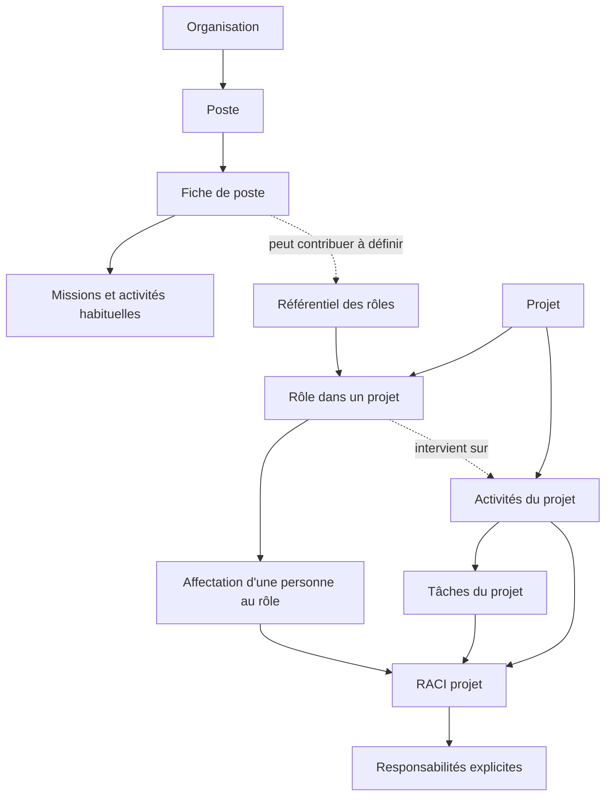

# Articulation entre postes, rôles, activités, tâches et RACI

**Statut :** cadrage fonctionnel — document de préparation V0.10  
**Périmètre :** organisation, fiches de poste, rôles projet et responsabilités  
**Principe :** ce document décrit le modèle fonctionnel cible. Il ne demande aucune modification du code de la V0.8.

## 1. Objectif

KHI Flows doit permettre de décrire l'organisation permanente d'une structure, puis de préciser comment les personnes contribuent à un projet donné.

Il faut éviter une confusion fréquente : considérer que la personne qui porte un intitulé de poste ou un rôle dans un projet est automatiquement responsable de toutes les activités associées au projet.

Exemple : une personne désignée comme **chef de projet** sur un projet n'est pas nécessairement responsable de l'avant-vente. Si l'avant-vente est réalisée par un commercial ou un responsable de compte, cette responsabilité doit rester attribuée à ce dernier dans le RACI.

Le modèle doit donc distinguer :
- ce qui relève de l'organisation permanente ;
- les rôles nécessaires à un projet ;
- les activités et tâches réellement réalisées ;
- les responsabilités attribuées aux personnes pour ce projet.

## 2. Définitions : ne pas confondre les notions

### 2.1 Poste

Le **poste** est une position dans l'organisation. Il décrit une fonction relativement stable, indépendamment d'un projet particulier.

Exemples :
- Chef de projet
- Directeur de projet
- Consultant fonctionnel
- Architecte technique
- Responsable commercial

Un poste est généralement rattaché à une entité, une équipe ou un service. Une personne peut occuper un ou plusieurs postes selon l'organisation.

Le poste répond à la question : **« Quelle fonction cette personne occupe-t-elle dans l'organisation ? »**

### 2.2 Fiche de poste

La **fiche de poste** décrit le contenu attendu d'un poste dans l'organisation. Elle formalise notamment :
- la finalité du poste ;
- son périmètre et ses limites ;
- ses missions et responsabilités habituelles ;
- les activités auxquelles il contribue ;
- ses interfaces avec les autres postes ;
- les compétences et l'autonomie attendues.

Une fiche de poste décrit un cadre de référence. Elle ne constitue pas, à elle seule, une affectation à toutes les tâches d'un projet.

### 2.3 Rôle

Un **rôle** est une fonction attendue dans un contexte donné, par exemple dans un projet, un processus ou une instance de gouvernance.

Exemples de rôles projet :
- Sponsor
- Chef de projet
- Responsable de lot
- Référent métier
- Responsable qualité
- Contributeur technique

Le rôle répond à la question : **« Quelle fonction cette personne doit-elle assurer dans ce contexte précis ? »**

Un rôle est donc contextuel. Une personne peut :
- assurer plusieurs rôles dans un même projet, si cela est explicitement prévu ;
- assurer des rôles différents d'un projet à l'autre ;
- ne pas exercer, dans un projet, toutes les missions habituellement associées à son poste.

Un rôle projet ne doit pas être confondu avec un rôle global donnant des droits d'accès à l'application. Les permissions applicatives constituent une notion distincte.

### 2.4 Activité

Une **activité** est un ensemble cohérent de travaux contribuant à un résultat. Elle peut regrouper plusieurs tâches.

Exemples :
- Avant-vente et contractualisation
- Cadrage du projet
- Planification et pilotage
- Conception de la solution
- Réalisation
- Recette et validation
- Livraison et clôture

L'activité répond à la question : **« Quel travail doit être réalisé ? »**

Une activité peut mobiliser plusieurs rôles et plusieurs personnes. Elle peut également être partagée entre plusieurs équipes.

### 2.5 Tâche

Une **tâche** est une unité de travail suffisamment précise pour être exécutée, suivie et, si nécessaire, affectée à une personne.

Exemples :
- Recueillir le besoin du client
- Préparer le planning initial
- Organiser le comité de pilotage
- Réaliser les tests d'intégration
- Envoyer le livrable pour validation

La tâche répond à la question : **« Quelle action concrète faut-il réaliser ? »**

Une tâche peut être rattachée à une activité et à un processus ou lot du projet. Elle possède son propre état d'avancement et peut avoir une ou plusieurs personnes affectées selon les règles de gestion retenues.

### 2.6 Responsabilité

La **responsabilité** précise la contribution attendue d'une personne ou d'un rôle pour une activité ou une tâche.

Elle ne découle pas automatiquement du titre du poste. Elle doit être explicitée dans le contexte concerné, notamment au moyen du RACI.

### 2.7 Fonction et vocabulaire recommandé

Le mot **fonction** est ambigu. Il peut désigner le poste occupé dans l'organisation (« fonction de chef de projet »), un domaine de contribution (« fonction de pilotage ») ou le rôle exercé dans un contexte. Pour le modèle KHI Flows, retenir :
- **Poste** : position relativement stable dans l'organisation.
- **Rôle** : contribution attendue dans un projet ou un autre contexte.
- **Mission** : grand domaine de contribution durable décrit dans une fiche de poste.
- **Fonction** : terme descriptif à éviter comme nom d'objet lorsque son sens n'est pas précisé.

Dans le langage courant, « emploi », « poste » et « fonction occupée » peuvent être employés comme synonymes. « Casquette » est un terme informel proche de rôle. En revanche, poste et rôle ne sont pas interchangeables dans le modèle : une personne occupant le poste de chef de projet peut exercer un autre rôle sur un projet donné, et un rôle peut être tenu par une personne issue d'un autre poste.

### 2.8 Activité, tâche et autres termes proches

| Termes | Relation | Terme à privilégier dans KHI Flows |
|---|---|---|
| Activité / opération | Parfois proches, mais « opération » peut aussi désigner une action élémentaire | **Activité** pour un ensemble cohérent de travaux |
| Tâche / action / travail élémentaire / work item | Termes proches ; une action décrit souvent le contenu d'une tâche | **Tâche** pour l'unité affectable et suivie |
| Mission / activité | Une mission est un domaine durable de contribution ; une activité est un ensemble de travaux dans un contexte donné | **Mission** dans la fiche de poste, **activité** dans le projet |
| Étape / phase / jalon | Non synonymes : séquence, période ou regroupement, et point de contrôle daté | Les conserver distincts |
| Responsable / réalisateur | Non synonymes : répondre du résultat et exécuter le travail | **A** et **R** dans le RACI |

**Activité et tâche ne sont pas synonymes.** Une activité regroupe un ou plusieurs travaux cohérents ; une tâche est une unité suffisamment précise pour être exécutée, affectée et suivie. Le niveau de granularité et le besoin de suivi déterminent le choix.

Exemple :
- **Activité :** préparer le lancement du projet.
  - **Tâche :** consolider les objectifs et le périmètre.
  - **Tâche :** préparer l'ordre du jour de la réunion de lancement.
  - **Tâche :** envoyer l'invitation aux participants.

Si un élément est suffisamment précis pour être exécuté et suivi seul, il peut être une tâche. S'il regroupe plusieurs tâches ou représente un domaine de travail plus large, il doit être modélisé comme une activité.

## 3. Comment les notions s'articulent

Le modèle logique peut être représenté ainsi :

Lecture importante :
- la fiche de poste aide à définir les missions et les compétences attendues ;
- le référentiel des rôles fournit des rôles réutilisables dans les projets ;
- le projet sélectionne les activités et tâches qui font partie de son périmètre ;
- les personnes sont affectées aux rôles du projet ;
- le RACI précise les responsabilités effectives pour les activités ou tâches retenues.

Il n'existe donc pas de propagation automatique du type « la personne est chef de projet, donc elle est responsable de toutes les tâches du projet ».

## 4. Exemple détaillé : poste de chef de projet

### 4.1 Exemple de fiche de poste

**Intitulé :** Chef de projet  
**Finalité :** organiser et piloter l'exécution d'un projet afin d'atteindre les objectifs convenus en respectant le périmètre, les délais, les coûts, la qualité et les modalités de gouvernance.

| Domaine | Missions et responsabilités habituelles |
|---|---|
| Cadrage | Contribuer à clarifier les objectifs, le périmètre, les livrables et les hypothèses |
| Organisation | Construire l'organisation projet, identifier les acteurs et clarifier les responsabilités |
| Planification | Construire et maintenir le planning, identifier les dépendances et jalons |
| Pilotage | Suivre l'avancement, les charges, les coûts, les risques et les points de blocage |
| Coordination | Organiser les réunions, coordonner les contributeurs et faciliter les arbitrages |
| Qualité | Organiser les contrôles, revues et validations prévus dans le dispositif projet |
| Communication | Préparer le reporting et communiquer les alertes aux parties prenantes |
| Clôture | Organiser le bilan, la clôture opérationnelle et la capitalisation |

**Limites du poste :**
- Le chef de projet ne réalise pas nécessairement lui-même les travaux des différents lots.
- Il ne devient pas automatiquement responsable métier, technique, commercial ou contractuel.
- Il n'est pas automatiquement responsable de l'avant-vente ni de la négociation commerciale.
- Il coordonne et pilote les responsabilités attribuées aux autres acteurs, sans se substituer à eux.

Cette fiche est un exemple de référence à adapter à l'organisation réelle. Elle ne signifie pas que toutes les missions sont présentes dans tous les projets.

### 4.2 Exemple d'un projet

Considérons un projet de mise en place d'une solution chez un client.

Les acteurs sont :
- **Responsable commercial** : porte la relation commerciale et l'avant-vente.
- **Chef de projet** : prend en charge le pilotage du projet après décision de lancement.
- **Responsable de lot technique** : organise et suit les travaux techniques.
- **Référent métier client** : exprime les besoins et valide les résultats métier.
- **Sponsor** : porte les objectifs et les arbitrages majeurs.

Dans cet exemple, la personne qui assure le rôle de chef de projet ne prend pas en charge le bloc « Avant-vente ».

### 4.3 Activités et responsabilités RACI

RACI signifie :
- **R — Responsible (réalisateur)** : réalise concrètement le travail.
- **A — Accountable (redevable / approbateur)** : porte la responsabilité finale du résultat et en répond. Il est recommandé de désigner un seul A par ligne.
- **C — Consulted (consulté)** : apporte un avis ou une expertise, dans un échange à double sens.
- **I — Informed (informé)** : reçoit l'information, sans être nécessairement sollicité pour contribuer.

Exemple de matrice RACI simplifiée :

| Activité / résultat | Resp. commercial | Chef de projet | Resp. lot technique | Référent métier | Sponsor |
|---|:---:|:---:|:---:|:---:|:---:|
| Qualification de l'opportunité | A/R | I | C | C | I |
| Proposition commerciale et chiffrage | A/R | C | C | I | I |
| Négociation et contractualisation | A/R | C | I | I | C |
| Cadrage opérationnel du projet | C | A/R | C | C | I |
| Planning et coordination | I | A/R | R | C | I |
| Réalisation du lot technique | I | A | R | C | I |
| Validation métier | I | C | C | A/R | I |
| Suivi global et reporting projet | I | A/R | C | C | I |
| Arbitrage majeur de périmètre | C | R | C | C | A |

Cette matrice est illustrative : la répartition réelle dépend du contrat, de la gouvernance et de l'organisation du projet. Une ligne RACI doit être définie pour un résultat ou un périmètre suffisamment clair. Si plusieurs résultats sont mélangés dans une même ligne, il faut la décomposer.

**Ce que montre l'exemple :**
- Le responsable commercial est A/R sur l'avant-vente et la contractualisation.
- Le chef de projet est informé de ces travaux ou consulté lorsque cela est utile ; il n'en devient pas responsable du seul fait de son rôle projet.
- Le chef de projet devient A/R sur le cadrage opérationnel et le pilotage global.
- Le responsable de lot réalise les travaux techniques.
- Le référent métier porte la validation métier.
- Le sponsor assume les arbitrages majeurs.

Le RACI rend ainsi explicite la répartition des responsabilités au lieu de la déduire d'un intitulé de poste.

### 4.4 Vue synthétique : poste, rôle et RACI

| Niveau | Exemple | Ce que cela définit |
|---|---|---|
| Poste organisationnel | Chef de projet | La fonction occupée dans l'organisation |
| Fiche de poste | Fiche « Chef de projet » | Les missions, compétences et limites habituelles |
| Rôle projet | Chef de projet du projet Alpha | La fonction exercée dans ce projet précis |
| Activité projet | Pilotage du projet | Le domaine de travail à réaliser |
| Tâche projet | Préparer le comité de pilotage | L'action concrète à exécuter |
| RACI | Chef de projet = A/R | La responsabilité attribuée pour cette activité ou tâche |

## 5. Règles fonctionnelles proposées pour KHI Flows

### 5.1 Référentiel organisationnel

Le référentiel d'organisation doit permettre de gérer :
- les postes ;
- les fiches de poste associées ;
- les missions et activités habituelles ;
- les compétences attendues ;
- les liens hiérarchiques ou fonctionnels, si le périmètre de l'application les couvre.

Un poste est un élément organisationnel relativement stable. Il ne doit pas être créé à nouveau pour chaque projet.

### 5.2 Référentiel des rôles

Le référentiel des rôles décrit les fonctions susceptibles d'être mobilisées dans un projet.

Pour chaque rôle, prévoir au minimum :
- un nom et une description ;
- sa finalité ;
- ses responsabilités typiques ;
- ses limites et exclusions ;
- les compétences utiles ;
- les postes qui peuvent habituellement contribuer à l'exercer, sans imposer une équivalence automatique.

Un poste peut contribuer à plusieurs rôles. Un rôle peut être exercé par des personnes occupant des postes différents.

### 5.3 Configuration d'un projet

Pour chaque projet, il faut pouvoir :
1. sélectionner les rôles utiles au projet ;
2. affecter une ou plusieurs personnes à ces rôles selon les règles retenues ;
3. sélectionner ou définir les activités et tâches du projet ;
4. établir le RACI pour ces activités ou tâches ;
5. vérifier que les responsabilités nécessaires sont attribuées ;
6. identifier les activités non prises en charge ou les responsabilités manquantes.

La présence d'un rôle dans le projet ne doit pas affecter automatiquement toutes les activités du projet.

### 5.4 Lien avec les processus et les tâches

Les activités et tâches peuvent provenir :
- d'un processus ou d'un modèle de processus ;
- d'un plan de projet ;
- d'une liste de tâches propre au projet.

Le RACI doit pouvoir être associé au niveau pertinent : activité, tâche ou étape de processus. Il faut éviter de dupliquer inutilement une responsabilité à plusieurs niveaux lorsque l'héritage est ambigu.

Si un RACI défini au niveau d'une activité est décliné sur ses tâches, les règles d'héritage doivent être explicites. Une responsabilité héritée doit pouvoir être identifiée comme telle et remplacée par une affectation spécifique lorsque nécessaire.

### 5.5 Ne pas confondre rôle métier et permission applicative

Un rôle « Chef de projet » dans un projet décrit une responsabilité métier. Il ne doit pas automatiquement donner tous les droits d'administration dans KHI Flows.

Les droits d'accès à l'application, les rôles métier et les responsabilités RACI doivent rester trois dimensions distinctes, même si des règles de correspondance peuvent être étudiées ultérieurement.

## 6. Parcours utilisateur cible

### Administration générale
1. Créer ou mettre à jour un poste.
2. Rédiger la fiche de poste correspondante.
3. Définir les missions, activités habituelles, compétences et limites.
4. Maintenir le référentiel des rôles projet.
5. Relier éventuellement les postes aux rôles qu'ils peuvent contribuer à exercer.

### Administration d'un projet
1. Ouvrir le projet.
2. Choisir les rôles nécessaires, par exemple Chef de projet, Responsable de lot et Référent métier.
3. Affecter les personnes aux rôles.
4. Définir les activités et tâches réellement incluses dans le projet.
5. Construire ou compléter le RACI.
6. Contrôler les lignes sans A, sans R ou avec plusieurs A, selon les règles de gouvernance retenues.
7. Vérifier que le RACI correspond bien au périmètre contractuel et opérationnel du projet.

## 7. Règles de cohérence et cas à traiter

- Une personne peut occuper un poste sans être affectée à un projet.
- Une personne peut exercer un rôle projet différent de son poste principal.
- Un rôle projet peut être partagé entre plusieurs personnes, si la répartition est explicitée.
- Une personne peut exercer plusieurs rôles dans un même projet, sous réserve de traiter les conflits de responsabilités.
- Le fait d'être chef de projet ne rend pas automatiquement responsable de l'avant-vente, de la réalisation technique ou de la validation métier.
- Une activité hors périmètre du projet ne doit pas apparaître comme une responsabilité implicite du chef de projet.
- Une ligne RACI doit permettre d'identifier clairement le résultat concerné, le A et le ou les R.
- Les changements d'affectation doivent être historisables ou, au minimum, traçables dans le contexte du projet.
- Les fiches de poste sont des références organisationnelles ; le RACI du projet est la référence pour la répartition effective des responsabilités dans ce projet.

## 8. Périmètre de préparation V0.10

Ce document sert de base à la conception fonctionnelle. Il ne préjuge pas du modèle de données existant ni des écrans déjà disponibles.

Avant tout développement, il faudra :
1. inventorier les objets et écrans existants concernant postes, fiches de poste, rôles, activités, tâches, acteurs et RACI ;
2. identifier les objets déjà présents à réutiliser ;
3. cartographier les relations existantes et les éventuelles ambiguïtés ;
4. définir les règles de création, d'affectation, d'héritage et de traçabilité ;
5. produire les parcours et maquettes ;
6. établir les critères d'acceptation et les tests.

### Hors périmètre immédiat
- Aucun développement fonctionnel dans la V0.8.
- Aucune modification immédiate du modèle de données.
- Aucune automatisation qui déduirait le RACI uniquement à partir du poste ou du rôle.
- Aucun déploiement lié à ce document.

## 9. Critères d'acceptation fonctionnels à instruire

La future implémentation devra permettre de démontrer que :
- les postes et fiches de poste sont gérés indépendamment des projets ;
- les rôles projet sont sélectionnés et affectés dans le contexte d'un projet ;
- les activités et tâches du projet sont identifiables ;
- le RACI peut attribuer des responsabilités différentes selon les activités et tâches ;
- le chef de projet n'est pas automatiquement responsable de toutes les activités ;
- l'avant-vente peut être attribuée au responsable commercial, sans affectation implicite au chef de projet ;
- les responsabilités manquantes ou incohérentes sont détectables ;
- les droits applicatifs restent distincts des rôles métier et du RACI.

---

**Décision de cadrage à retenir :** le poste décrit la fonction dans l'organisation, le rôle décrit la fonction exercée dans un contexte, l'activité et la tâche décrivent le travail à réaliser, et le RACI décrit qui réalise, qui est redevable, qui est consulté et qui est informé. Ces notions sont liées, mais aucune ne doit être déduite automatiquement d'une autre.
